# API Gestion des Stages : FastAPI · SQLite · Docker · Render

Mini-projet **Cloud Computing, Microservices et API**.
API REST permettant à une école d'ingénieurs de gérer les stages de ses étudiants, conteneurisée avec Docker et déployée sur le cloud public Render.

| | |
|---|---|
| **URL publique (Render)** | https://gestion-stages-api-iy5u.onrender.com |
| **Documentation Swagger** | https://gestion-stages-api-iy5u.onrender.com/docs |
| **Dépôt GitHub** | https://github.com/haliait/gestion-stages-api |
| **Trinôme** | *AIT HAMOU Halima* - *GUIHIA Imane* - *BOURJILA Wiame*  |

> ⚠️ Exercice pédagogique : données **fictives** uniquement. Sur le plan gratuit de Render, le service se met en veille après 15 min sans trafic (premier appel ≈ 1 min) et la base SQLite est réinitialisée à chaque redémarrage ou redéploiement.

---

## 1. Technologies

| Rôle | Choix |
|---|---|
| Langage / framework API | Python 3.12 · FastAPI |
| Base de données | SQLite (via SQLAlchemy 2) |
| Validation des données | Pydantic (génère aussi la doc OpenAPI/Swagger) |
| Serveur | Uvicorn |
| Conteneurisation | Docker (`python:3.12-slim`) |
| Cloud (PaaS) | Render, Web Service, environnement Docker, plan Free |
| Tests | Swagger UI, Postman, curl, pytest |

## 2. Structure du projet

```
gestion-stages-api/
├── app/
│   ├── main.py        # Application FastAPI + endpoints + journalisation des requêtes
│   ├── database.py    # Connexion SQLite (SQLAlchemy)
│   ├── models.py      # Table "stages"
│   ├── schemas.py     # Schémas JSON d'entrée/sortie + validation des dates
│   └── crud.py        # Opérations Create / Read / Update / Delete
├── tests/test_api.py  # 10 tests automatisés (pytest)
├── postman/Gestion_Stages.postman_collection.json
├── scripts/test_api.sh / test_api.ps1   # Tests de bout en bout (curl / PowerShell)
├── captures/          # Captures d'écran pour le rendu
├── Dockerfile
├── requirements.txt   # Dépendances de l'API
└── requirements-dev.txt  # + outils de test
```

## 3. Modèle de données : `Stage`

| Champ | Type | Contrainte |
|---|---|---|
| `id` | entier | généré automatiquement |
| `nom_etudiant` | texte | obligatoire, 1–100 caractères |
| `entreprise` | texte | obligatoire, 1–100 caractères |
| `intitule` | texte | obligatoire, 1–200 caractères |
| `date_debut` | date `AAAA-MM-JJ` | obligatoire |
| `date_fin` | date `AAAA-MM-JJ` | obligatoire, ≥ `date_debut` |

## 4. Endpoints

| Méthode | URI | Description | Succès | Erreurs |
|---|---|---|---|---|
| `GET` | `/` | Message d'accueil + liens | 200 | — |
| `GET` | `/health` | État du service | 200 | — |
| `GET` | `/stages` | Liste des stages (filtre optionnel `?entreprise=`, pagination `skip`, `limit`) | 200 | — |
| `GET` | `/stages/{id}` | Consulter un stage | 200 | 404 |
| `POST` | `/stages` | Créer un stage | **201** | 422 |
| `PUT` | `/stages/{id}` | Modifier un stage (remplacement complet) | 200 | 404, 422 |
| `DELETE` | `/stages/{id}` | Supprimer un stage | 200 | 404 |

**Codes d'erreur**
- `404 Not Found` : le stage demandé n'existe pas → `{"detail": "Stage avec l'id 42 introuvable"}`
- `422 Unprocessable Entity` : données invalides (champ manquant, date mal formée, date de fin avant la date de début)

### Exemples

**Créer un stage**
```http
POST /stages
Content-Type: application/json

{
  "nom_etudiant": "Étudiant Test",
  "entreprise": "Entreprise Démo",
  "intitule": "Développement d'une API REST",
  "date_debut": "2026-02-01",
  "date_fin": "2026-07-31"
}
```
Réponse `201 Created` :
```json
{
  "id": 1,
  "nom_etudiant": "Étudiant Test",
  "entreprise": "Entreprise Démo",
  "intitule": "Développement d'une API REST",
  "date_debut": "2026-02-01",
  "date_fin": "2026-07-31"
}
```

**Modifier** : `PUT /stages/1` avec le même format de corps (tous les champs).

**Supprimer** : `DELETE /stages/1` → `{"message": "Stage 1 supprimé avec succès"}`

## 5. Lancer le projet

### En local (Python 3.11 ou plus)
```bash
python -m venv .venv
# Windows : .venv\Scripts\activate     |  macOS/Linux : source .venv/bin/activate
pip install -r requirements-dev.txt
uvicorn app.main:app --reload
```
→ http://127.0.0.1:8000/docs

### Avec Docker
```bash
docker build -t gestion-stages-api .
docker run -d -p 8000:8000 --name stages-api gestion-stages-api
```
→ http://localhost:8000/docs

### Tests
```bash
pytest -v                                   # tests automatisés
./scripts/test_api.sh https://gestion-stages-api-iy5u.onrender.com     # curl (bash)
.\scripts\test_api.ps1 -BaseUrl https://gestion-stages-api-iy5u.onrender.com   # PowerShell
```
Postman : importer `postman/Gestion_Stages.postman_collection.json`, régler la variable `baseUrl`, puis *Run collection*.

## 6. Déploiement sur Render

1. Code poussé sur GitHub.
2. Render → **New → Web Service** → connexion du dépôt GitHub.
3. **Language : Docker**, **Instance type : Free**, (Advanced) *Health Check Path* : `/health`.
4. **Create Web Service** → Render construit l'image depuis le `Dockerfile` et la lance. Render fournit la variable `PORT` (10000), que le `Dockerfile` utilise automatiquement.
5. URL publique : https://gestion-stages-api-iy5u.onrender.com
6. Déploiement continu (CI/CD) : chaque `git push` sur la branche `main` déclenche automatiquement une reconstruction et un redéploiement sur Render.

## 7. Captures d'écran

### Partie 2 : Tests de l'API avec Swagger (local)

**Vue d'ensemble des endpoints**
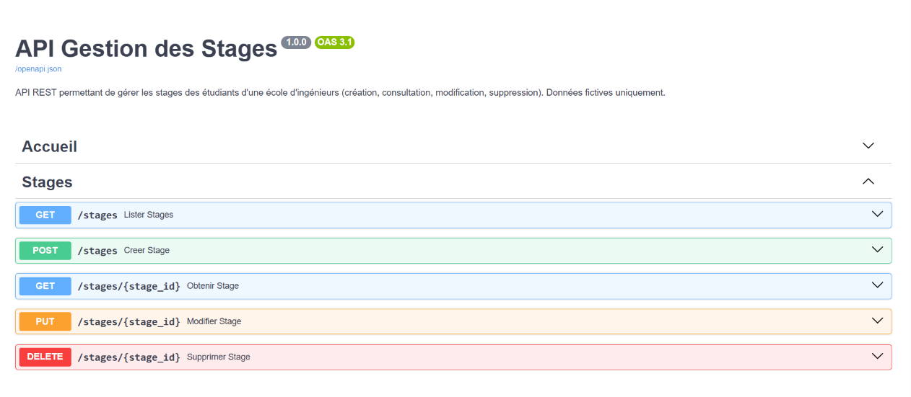

**Création d'un stage : `POST /stages` → 201 Created**
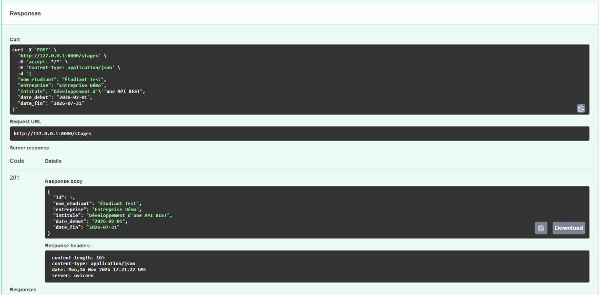

**Consultation de la liste : `GET /stages` → 200 OK**
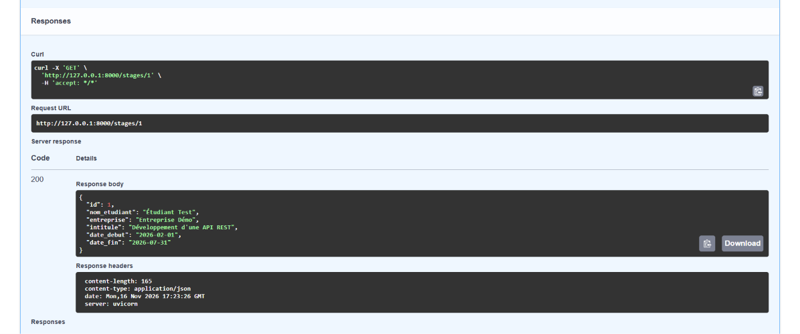

**Modification : `PUT /stages/{id}` → 200 OK**
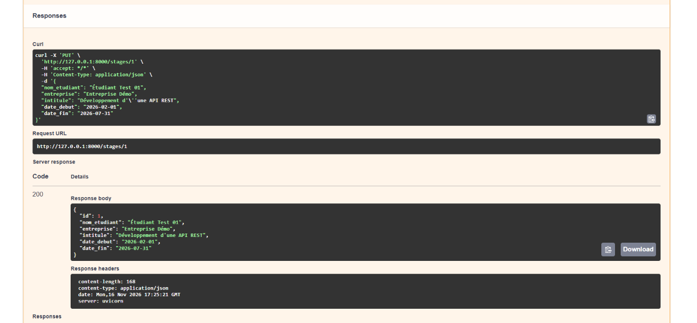

**Suppression : `DELETE /stages/{id}` → 200 OK**
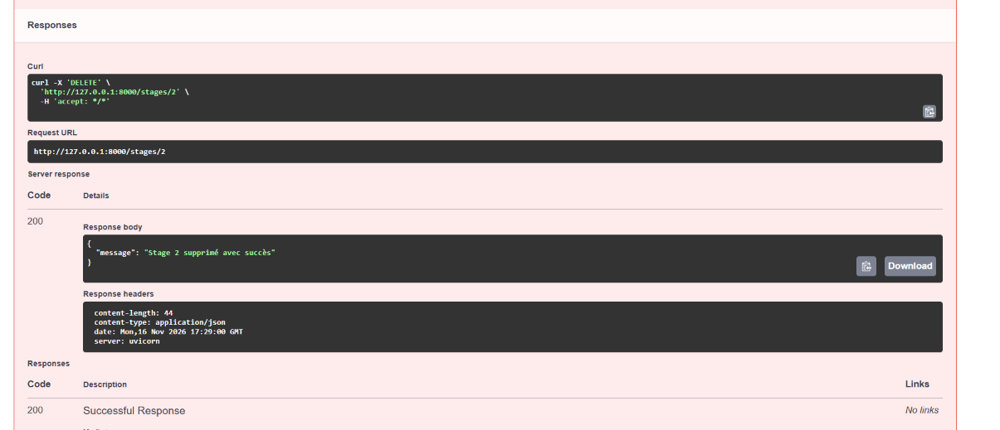

**Stage inexistant : `GET /stages/{id}` → 404 Not Found**
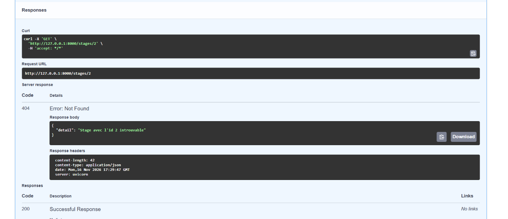

### Partie 3 : Conteneurisation Docker

**Construction de l'image : `docker build`**
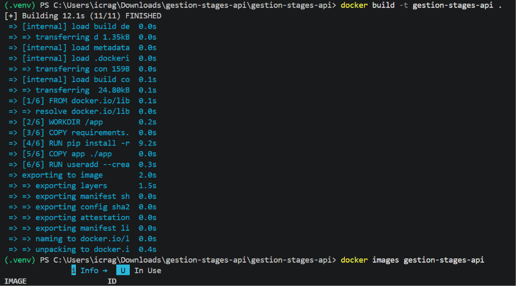

**Conteneur en cours d'exécution : `docker ps`**
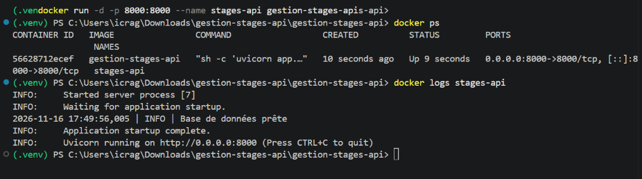

**API et Swagger accessibles depuis le conteneur (`localhost:8000/docs`)**
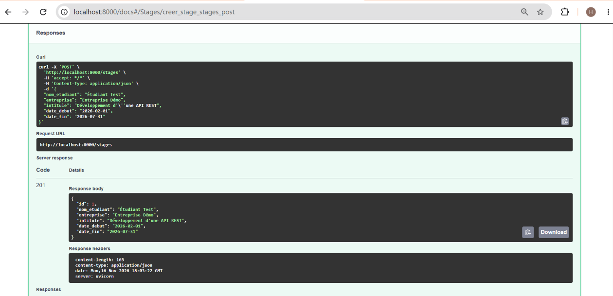

**Tests de bout en bout sur le conteneur (8/8 OK)**
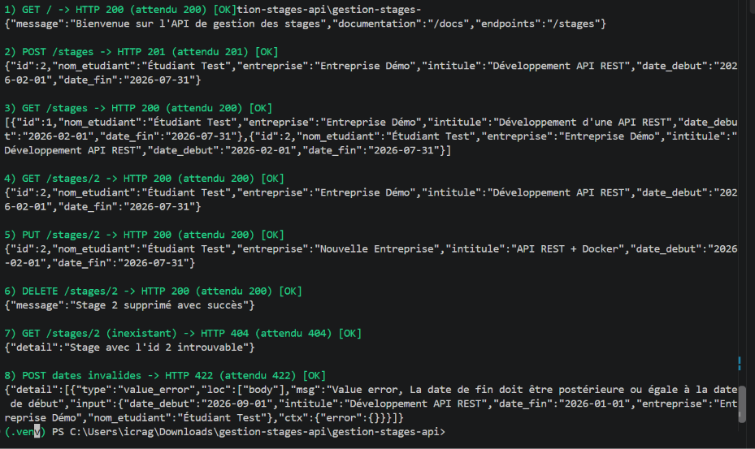

### Partie 4 : Déploiement sur Render

**Service déployé (statut Live) et URL publique**
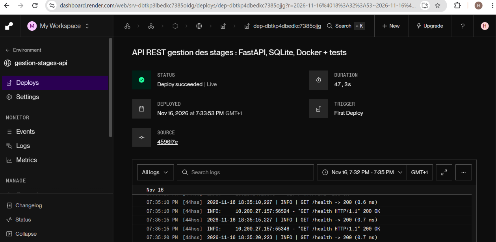

**Logs de démarrage sur Render**
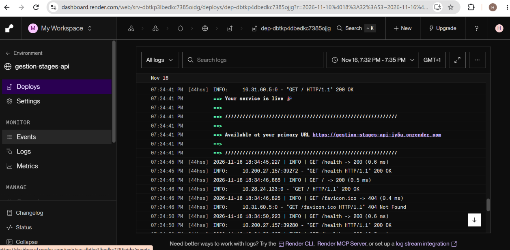

**Swagger accessible publiquement depuis Internet**
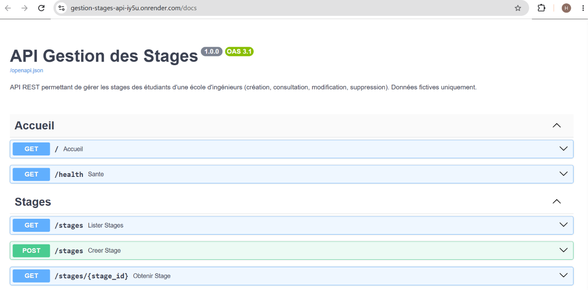

**Tests des endpoints sur l'URL publique**
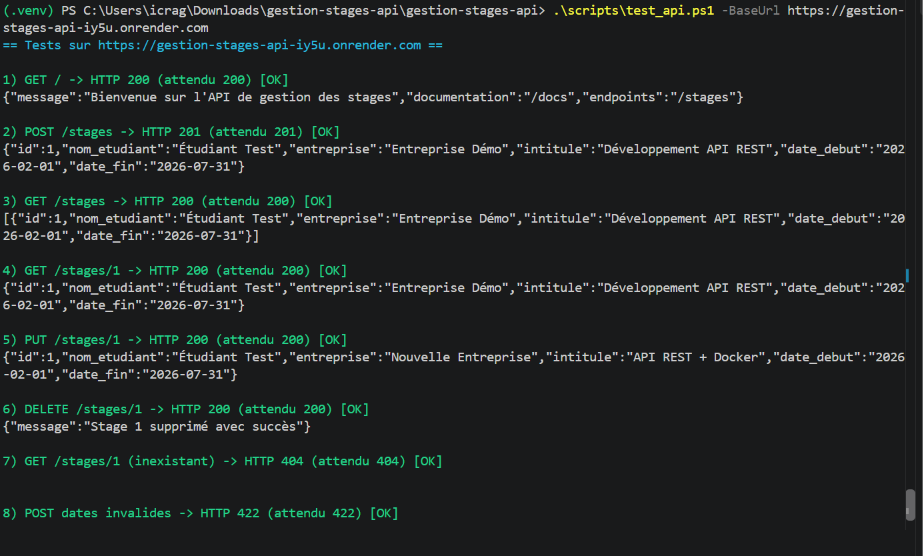
